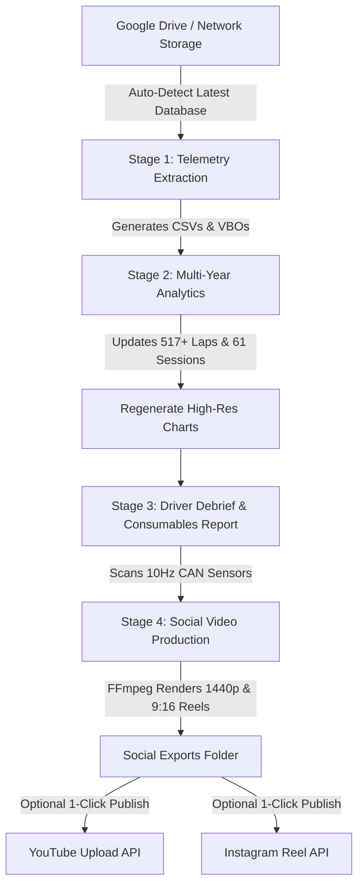

# 🏁 Porsche Track Precision App — Automated Pit Lane & Social Pipeline

An autonomous post-event analytics, telemetry debrief, and social media production system for the **Porsche 718 Cayman GT4** at **High Plains Raceway**.

---

## 🚀 Sunday Night Routine: "The 1-Click Hand-off"

When returning from a track weekend, your entire job is just two actions:
1. **Drop your files into Google Drive:**
   * Export the PTPA database backup (`.mdb` or `.tparecord`) to `D:\My Drive\Database Backups\` (or project folder).
   * Put your raw session videos into `\\THOR\plex\Cayman Videos\` (or Google Drive).
2. **Tell Antigravity:**
   > *"Antigravity, start work on all post-event activities."*
   *(Or run `python post_event_pipeline.py` in your terminal).*

**Everything else happens automatically.**

---

## ⚡ What the Master Pipeline (`post_event_pipeline.py`) Executes



### 1. Stage 1: Ingestion & Sync
* Scans Google Drive (`D:\My Drive\Database Backups\`) and local directories for the latest database backup.
* Extracts any new sessions into `Recording CSVs/` and Racelogic `Recording VBOs/`.

### 2. Stage 2: Multi-Year Analytics & Visual Charts
* Updates [`detailed_lap_analysis.csv`](file:///c:/Users/Darig/Projects/Porsche%20Track%20App/detailed_lap_analysis.csv) (all 517 timed laps).
* Updates [`analysis_summary.md`](file:///c:/Users/Darig/Projects/Porsche%20Track%20App/analysis_summary.md) (session breakdown table across all 61 sessions).
* Regenerates all dark-mode motorsport charts in [`charts/`](file:///c:/Users/Darig/Projects/Porsche%20Track%20App/charts/):
  * `best_lap_time_trend.png` — Lap time progression curve & PB frontier annotation (2:16 $\rightarrow$ 1:59.60).
  * `wot_throttle_progression.png` — Driver commitment (% of lap spent at Wide Open Throttle).
  * `max_gforce_trend.png` — Peak lateral grip & threshold braking deceleration evolution.
  * `max_speed_trend.png` — Straightaway top speed evolution (up to 134.8 mph).
  * `track_map_comparison.png` — GPS racing line map.

### 3. Stage 3: Driver Debrief & Consumables Inspection
* Generates [`POST_EVENT_DEBRIEF.md`](file:///c:/Users/Darig/Projects/Porsche%20Track%20App/POST_EVENT_DEBRIEF.md):
  * Weekend best lap vs Top 5 average pace.
  * Consistency window (laps within 1.5s of PB).
  * Tire hot pressures (FL, FR, RL, RR) measured against the 30.5 PSI benchmark.
  * Historical drop from 2024 baseline.

### 4. Stage 4: Social Media Video Engine
* Identifies highlight moments across 100,000+ CAN frames via [`telemetry_scout.py`](file:///c:/Users/Darig/Projects/Porsche%20Track%20App/telemetry_scout.py).
* Auto-renders video assets using hardware-accelerated FFmpeg into `\\THOR\plex\Cayman Videos\Social Exports\`:
  * **YouTube 1440p Master:** 16:9 full hot lap upscaled to 1440p to force YouTube's premium VP9/AV01 codec.
  * **Instagram 9:16 Vertical Reels:** Blurred-background letterbox format with UI safe zones and branded telemetry badges.
* Generates [`upload_manifest.md`](file://///THOR/plex/Cayman%20Videos/Social%20Exports/upload_manifest.md) with copy-paste titles, descriptions, and hashtags.

### 5. Stage 5: Autonomous Uploads
* **YouTube (`youtube_uploader.py`):** Uses official Google YouTube Data API v3 with cached OAuth tokens (`youtube_token.json`).
* **Instagram (`instagram_uploader.py`):** Uses authenticated session profile (`instagram_session.json`) to publish Reels directly.

---

## 📱 Weekly Social Media Release Cadence

| Day | Platform | Format | Recommended Content & Purpose |
| :--- | :--- | :--- | :--- |
| **Sunday Evening / Monday** | **YouTube Main** | 1440p Landscape (16:9) | **Weekend Hero Lap** (Your fastest full lap PB with complete telemetry) |
| **Monday Lunch** | **YouTube Shorts** | 9:16 Vertical (44s) | **Milestone Sprint Short** (44s finish line crossing — drives subscriber reach) |
| **Monday Lunch** | **Instagram Reels** | 9:16 Vertical (44s) | **Milestone Sprint Reel** (44s finish line crossing hitting 1:59.62) |
| **Tuesday** | **Instagram Carousel** | Multi-slide Images | **Data Progression Post** (Lap time trend, WOT %, lateral G charts from `charts/`) |
| **Wednesday** | **YouTube Shorts** | 9:16 Vertical (20s) | **Peak Grip Short** (1.54G carousel apex at 81 mph) |
| **Wednesday** | **Instagram Reels** | 9:16 Vertical (20s) | **Peak Grip Reel** (1.54G carousel apex at 81 mph) |
| **Thursday** | **Instagram Reels** | 9:16 Vertical (2:01) | **Sunday Consistency Follow-up** (Back-to-back 2:00.12 lap) |
| **Friday / Weekend** | **YouTube Playlist** | 1080p Full Sessions | **Full Session Archives** (Unlisted/Public for coaches & local HPR drivers) |

---

## 📂 Project Organization & Directory Layout

```text
Porsche Track App/
├── post_event_pipeline.py          # Master 1-click entry point
├── analyze_track_data.py           # Telemetry analytics engine
├── extract_all_ptpa_sessions.py    # Database -> CSV / VBO extractor
├── telemetry_scout.py              # 10Hz CAN-bus scout for Gs & saves
├── auto_social_engine.py           # FFmpeg clipping & reel generator
├── youtube_uploader.py             # Official YouTube Data API v3 uploader
├── instagram_uploader.py           # Personal Instagram Reel publisher
│
├── charts/                         # Updated multi-year high-res plots
│   ├── best_lap_time_trend.png
│   ├── max_gforce_trend.png
│   ├── max_speed_trend.png
│   ├── track_map_comparison.png    # PB (1:59.60) vs GT4 Best-in-Class (1:56.86)
│   └── wot_throttle_progression.png
│
├── Recording CSVs/                 # 61 standardized telemetry session files
├── Recording VBOs/                 # 61 Racelogic-compatible session files
├── Best in Class Recording/        # Benchmark PTPA GT4 sessions (1:56.862 CSV & VBO)
├── tpa_records/                    # 64 raw .tparecord zip archives
├── logs/                           # System and PTPA logs
│
├── POST_EVENT_DEBRIEF.md           # Executive driver debrief & consumables report
├── analysis_summary.md             # Complete 61-session breakdown markdown table
├── detailed_lap_analysis.csv       # Lap-by-lap data for 519 timed laps
├── TRACK_SOCIAL_WORKFLOW.md        # Detailed social media runbook
│
├── client_secrets.json             # Google Cloud OAuth app config
├── youtube_token.json              # Cached YouTube authorization token
└── instagram_session.json          # Cached Instagram session profile
```

---

## 🛠️ Command Cheat Sheet

```bash
# Run the complete post-event pipeline (Extraction + Analysis + Debrief + Social):
python post_event_pipeline.py

# Run analysis and social clipping while skipping database extraction:
python post_event_pipeline.py --skip-extract

# Run full pipeline AND automatically publish to YouTube and Instagram:
python post_event_pipeline.py --upload-youtube --upload-instagram
```
