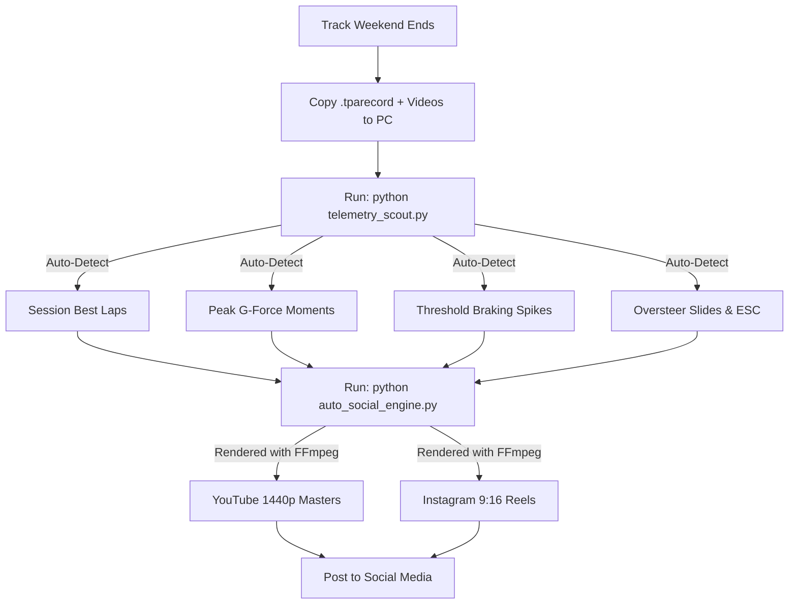

# Trackside to Social Media: Automated Post-Weekend Runbook

This runbook provides a **zero-manual-editing, repeatable workflow** to take raw track recordings and CAN telemetry from the Porsche Track Precision App (PTPA) and turn them into ready-to-post **YouTube 1440p masters** and **Instagram 9:16 vertical Reels**.

---

## 🏎️ Overview of the Architecture



---

## 📋 The Step-by-Step Runbook (Do This After Every Track Weekend)

### Step 1: Ingest Files from Phone / GoPro
1. Connect your phone or GoPro to your PC.
2. Copy your exported session video files into your storage directory:
   * Target: `\\THOR\plex\Cayman Videos\`
3. Export your PTPA database backup (`.mdb` or `.tparecord` files) to this project directory:
   * Target: `c:\Users\Darig\Projects\Porsche Track App\`

---

### Step 2: Run the Telemetry Scout (Takes 2 Seconds)
Open a terminal in the project directory and run:
```bash
python telemetry_scout.py
```

**What it does automatically:**
* Scans every 10Hz CAN-bus telemetry frame across all sessions.
* Outputs the exact millisecond video timestamps for:
  * **Session Best Laps** (start time $\rightarrow$ finish line crossing).
  * **Top 5 Highest Lateral G Moments** (knife-edge cornering).
  * **Top 5 Threshold Braking Points** (deep deceleration spikes).
  * **Top 5 Oversteer / Chassis Rotation Moments** (`wpoOversteer` & steering corrections).

---

### Step 3: Render Social Media Assets (Takes 1-2 Minutes)
Run the automated clipping and rendering engine:
```bash
python auto_social_engine.py
```
Or run the milestone export:
```bash
python export_social_videos.py
```

All rendered files are automatically saved to:
📁 `\\THOR\plex\Cayman Videos\Social Exports\`

---

## 🎨 Asset Output Specifications

### 1. YouTube 1440p Landscape Masters (`2560x1440` @ 16:9)
* **Resampling:** Lanczos 1440p scaling with `-movflags +faststart`.
* **Purpose:** Triggers YouTube's premium **VP09 / AV01** codec tier, ensuring telemetry gauges, dashboard numbers, and high-speed pavement textures remain razor-sharp.
* **Suggested Title Template:**
  > `Porsche 718 Cayman GT4 | [Lap Time] at High Plains Raceway (Session [X]) [Full Telemetry]`

### 2. Instagram 9:16 Vertical Reels (`1080x1920`)
* **Layout:**
  * **Top 25%:** Branded bold header with car model + highlight badge.
  * **Center 50%:** Full 16:9 track video with complete telemetry HUD intact.
  * **Background:** Heavy gaussian box blur (`boxblur=25:5`) darkened by 22% to eliminate black bars.
  * **Safe-Zone Offset:** Video is shifted up -60px so Instagram's bottom caption and side icons (Like, Comment, Share) **never cover your gauges or speed**.
  * **Bottom 25%:** Event stat badge (e.g. `1.54G PEAK LATERAL LOAD | 81 MPH CORKSCREW APEX`).

---

## 🎯 Audience Strategy: YouTube vs. Instagram Positioning

While both platforms use 9:16 vertical video, they cater to very different viewer mindsets:

| Platform | Core Viewer Motivation | Content Angle | Algorithmic Driver | Optimization Tactic |
| :--- | :--- | :--- | :--- | :--- |
| **YouTube Shorts** | Technical curiosity, lap comparisons, telemetry analysis | **Data & Technique:** G-forces, braking points, speedometer, delta clock | **High Retention & Rewatches** (>85% APV) | Link Shorts to 1440p master via YouTube Studio **"Related Video"** |
| **Instagram Reels** | Visceral excitement, engine sound, driver journey | **Emotion & Story:** Milestone journey (2:16 $\rightarrow$ 1:59), flat-6 scream | **Shares & Saves** | First 2s text hook + thought-provoking caption questions |
| **Instagram Carousel** | Deep-dive trackday setup, tire dynamics, track reference | **Engineering Debrief:** 4:5 vertical data slides & charts | **Saves for Track Prep** | 6-slide livery deck with tire pressure & trail-braking notes |

---

## 📱 Weekly Social Media Release Cadence

| Day | Platform | Format | Recommended Content & Purpose |
| :--- | :--- | :--- | :--- |
| **Sunday Evening / Monday** | **YouTube Main** | 1440p Landscape (16:9) | **Weekend Hero Lap** (Your fastest full lap PB with complete telemetry) |
| **Monday Lunch** | **YouTube Shorts** | 9:16 Vertical (44s) | **Milestone Sprint Short** (44s finish line crossing — drives subscriber reach) |
| **Monday Lunch** | **Instagram Reels** | 9:16 Vertical (44s) | **Milestone Sprint Reel** (44s finish line crossing hitting 1:59.62) |
| **Tuesday** | **Instagram Carousel** | Multi-slide Images | **Data Progression Post** (Lap time trend, WOT %, lateral G charts from `charts/`) |
| **Wednesday** | **YouTube Shorts** | 9:16 Vertical (20s) | **Peak Grip Short** (1.54G corkscrew apex at 81 mph) |
| **Wednesday** | **Instagram Reels** | 9:16 Vertical (20s) | **Peak Grip Reel** (1.54G corkscrew apex at 81 mph) |
| **Thursday** | **Instagram Reels** | 9:16 Vertical (2:01) | **Sunday Consistency Follow-up** (Back-to-back 2:00.12 lap) |
| **Friday / Weekend** | **YouTube Playlist** | 1080p Full Sessions | **Full Session Archives** (Unlisted/Public for coaches & local HPR drivers) |

---

## 🚀 Automated Uploads (Optional 1-Click Publishing)

### YouTube Direct Upload:
1. Ensure your one-time Google OAuth `client_secrets.json` is in the project folder.
2. Run:
```bash
python youtube_uploader.py --file "\\THOR\plex\Cayman Videos\Social Exports\2026-10-10_HPR_GT4_1m59s_PB_YouTube_1440p.mp4" --title "Porsche 718 Cayman GT4 | Sub-2:00 at High Plains Raceway (1:59.62 PB)" --privacy public
```

### Instagram Reel Upload (Personal Account):
1. **One-time session authentication** (run directly in your terminal once):
```bash
python auth_instagram.py
```
*(Prompts securely for your username/password and optional 2FA code, saving your encrypted session to `instagram_session.json`).*

2. **Publish Reel** (100% automated using cached session):
```bash
python instagram_uploader.py --file "\\THOR\plex\Cayman Videos\Social Exports\2026-10-10_HPR_GT4_1m59s_PB_Instagram_Highlight_44s.mp4" --caption "Finally cracked the 2-minute barrier at High Plains Raceway 🏁 1:59.62 in the 718 GT4! Full lap on YouTube #Porsche #718GT4 #TrackDay"
```

3. **Publish Carousel** (Tuesday 4:5 Data Progression Post):
```bash
python generate_carousel_slides.py
python instagram_uploader.py --carousel-dir charts/carousel --caption-file charts/carousel/caption.txt
```

### Rennlist Forum Thread Generation:
1. **Generate BBCode & Markdown Thread**:
```bash
python generate_rennlist_thread.py
```
2. **Review & Publish**:
   * Open [`reports/rennlist_thread_bbcode.txt`](file:///c:/Users/Darig/Projects/Porsche%20Track%20App/reports/rennlist_thread_bbcode.txt).
   * Copy the formatted BBCode into the **718 GT4 / Spyder** or **Racing & Drivers Ed** forum on [Rennlist](https://rennlist.com/forums/718-gts-4-0-gt4-gt4-rs-spyder-250/).
   * Video embed, telemetry tables, and tire setup takeaways are automatically pre-formatted.

---

## 🛠️ Tooling & Scripts Reference

* [`process_weekend_for_social.py`](file:///c:/Users/Darig/Projects/Porsche%20Track%20App/process_weekend_for_social.py) — **Master 1-click orchestrator:** scans telemetry, renders all clips, and generates `upload_manifest.md`.
* [`generate_rennlist_thread.py`](file:///c:/Users/Darig/Projects/Porsche%20Track%20App/generate_rennlist_thread.py) — Builds publication-ready BBCode threads for Rennlist with embedded YouTube masters and CAN delta tables.
* [`generate_carousel_slides.py`](file:///c:/Users/Darig/Projects/Porsche%20Track%20App/generate_carousel_slides.py) — Renders 4:5 vertical (`1080x1350`) Instagram carousel slides in official Porsche Motorsport livery.
* [`telemetry_scout.py`](file:///c:/Users/Darig/Projects/Porsche%20Track%20App/telemetry_scout.py) — 10Hz CAN-bus scanner for G-forces, oversteer, and best lap timestamps.
* [`auto_social_engine.py`](file:///c:/Users/Darig/Projects/Porsche%20Track%20App/auto_social_engine.py) — Reusable FFmpeg renderer for custom highlight reels and 1440p YouTube masters.
* [`youtube_uploader.py`](file:///c:/Users/Darig/Projects/Porsche%20Track%20App/youtube_uploader.py) — Official YouTube Data API v3 uploader with progress tracking.
* [`auth_instagram.py`](file:///c:/Users/Darig/Projects/Porsche%20Track%20App/auth_instagram.py) — One-time personal Instagram account session authenticator.
* [`instagram_uploader.py`](file:///c:/Users/Darig/Projects/Porsche%20Track%20App/instagram_uploader.py) — Personal Instagram Reel and Carousel publisher with session caching & 2FA support.

