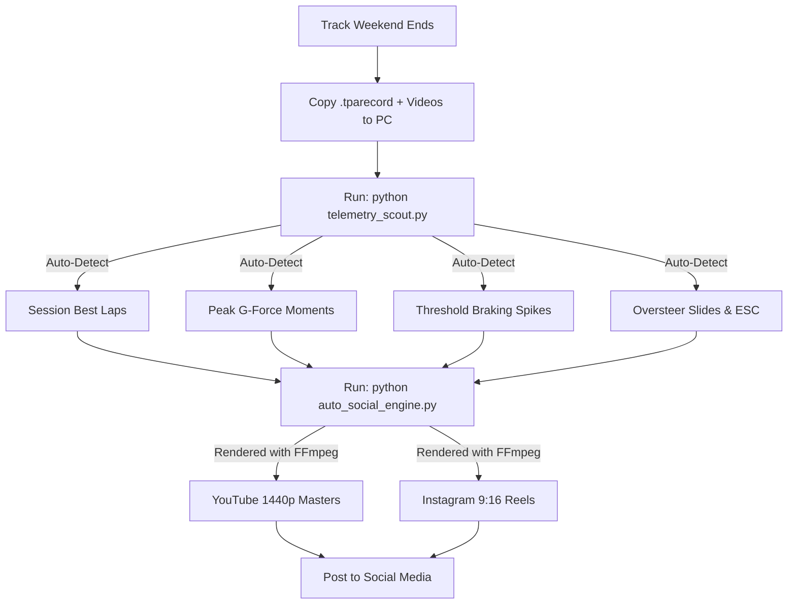

# Trackside to Social Media: Automated Post-Weekend Runbook

This runbook provides a **zero-manual-editing, repeatable workflow** to take raw track recordings and CAN telemetry from the Porsche Track Precision App (PTPA) and turn them into ready-to-post **YouTube 1440p masters** and **Instagram 9:16 vertical Reels**.

---

## 🏎️ Overview of the Architecture



---

## 📋 The Step-by-Step Runbook (Do This After Every Track Weekend)

### Step 1: Ingest Files from Phone / GoPro
1. Connect your phone or GoPro to your PC.
2. Copy your exported session video files into your storage directory:
   * Target: `\\THOR\plex\Cayman Videos\`
3. Export your PTPA database backup (`.mdb` or `.tparecord` files) to this project directory:
   * Target: `c:\Users\Darig\Projects\Porsche Track App\`

---

### Step 2: Run the Telemetry Scout (Takes 2 Seconds)
Open a terminal in the project directory and run:
```bash
python telemetry_scout.py
```

**What it does automatically:**
* Scans every 10Hz CAN-bus telemetry frame across all sessions.
* Outputs the exact millisecond video timestamps for:
  * **Session Best Laps** (start time $\rightarrow$ finish line crossing).
  * **Top 5 Highest Lateral G Moments** (knife-edge cornering).
  * **Top 5 Threshold Braking Points** (deep deceleration spikes).
  * **Top 5 Oversteer / Chassis Rotation Moments** (`wpoOversteer` & steering corrections).

---

### Step 3: Render Social Media Assets (Takes 1-2 Minutes)
Run the automated clipping and rendering engine:
```bash
python auto_social_engine.py
```
Or run the milestone export:
```bash
python export_social_videos.py
```

All rendered files are automatically saved to:
📁 `\\THOR\plex\Cayman Videos\Social Exports\`

---

## 🎨 Asset Output Specifications

### 1. YouTube 1440p Landscape Masters (`2560x1440` @ 16:9)
* **Resampling:** Lanczos 1440p scaling with `-movflags +faststart`.
* **Purpose:** Triggers YouTube's premium **VP09 / AV01** codec tier, ensuring telemetry gauges, dashboard numbers, and high-speed pavement textures remain razor-sharp.
* **Suggested Title Template:**
  > `Porsche 718 Cayman GT4 | [Lap Time] at High Plains Raceway (Session [X]) [Full Telemetry]`

### 2. Instagram 9:16 Vertical Reels (`1080x1920`)
* **Layout:**
  * **Top 25%:** Branded bold header with car model + highlight badge.
  * **Center 50%:** Full 16:9 track video with complete telemetry HUD intact.
  * **Background:** Heavy gaussian box blur (`boxblur=25:5`) darkened by 22% to eliminate black bars.
  * **Safe-Zone Offset:** Video is shifted up -60px so Instagram's bottom caption and side icons (Like, Comment, Share) **never cover your gauges or speed**.
  * **Bottom 25%:** Event stat badge (e.g. `1.54G PEAK LATERAL LOAD | 81 MPH CORKSCREW APEX`).

---

## 🎯 Audience Strategy: YouTube vs. Instagram Positioning

While both platforms use 9:16 vertical video, they cater to very different viewer mindsets:

| Platform | Core Viewer Motivation | Content Angle | Algorithmic Driver | Optimization Tactic |
| :--- | :--- | :--- | :--- | :--- |
| **YouTube Shorts** | Technical curiosity, lap comparisons, telemetry analysis | **Data & Technique:** G-forces, braking points, speedometer, delta clock | **High Retention & Rewatches** (>85% APV) | Link Shorts to 1440p master via YouTube Studio **"Related Video"** |
| **Instagram Reels** | Visceral excitement, engine sound, driver journey | **Emotion & Story:** Milestone journey (2:16 $\rightarrow$ 1:59), flat-6 scream | **Shares & Saves** | First 2s text hook + thought-provoking caption questions |
| **Instagram Carousel** | Deep-dive trackday setup, tire dynamics, track reference | **Engineering Debrief:** 4:5 vertical data slides & charts | **Saves for Track Prep** | 6-slide livery deck with tire pressure & trail-braking notes |

---

## 📱 Phase 1 Cadence: Post-Weekend Launch (✅ COMPLETED & ARCHIVED)

> [!NOTE]
> All Phase 1 launch assets were successfully published following the October 10–11 track weekend. Kept here for historical reference.

| Day | Platform | Format | Published Content & Live Links |
| :--- | :--- | :--- | :--- |
| **Sunday / Monday** | **YouTube Main** | 1440p Landscape (16:9) | **Weekend Hero Lap** (Official PB 1440p Master) — [Watch on YouTube](https://youtu.be/PRz7gJhED00) |
| **Monday Lunch** | **YouTube Shorts** | 9:16 Vertical (44s) | **Milestone Sprint Short** (44s finish line crossing hitting 1:59.62) |
| **Monday Lunch** | **Instagram Reels** | 9:16 Vertical (44s) | **Milestone Sprint Reel** — [View Reel](https://www.instagram.com/reel/Dehh9HZRDYf/) |
| **Tuesday** | **Instagram Carousel** | 6-Slide Livery Deck | **2-Year Data Progression Post** (2:16 to 1:59.62) — [View Carousel](https://www.instagram.com/p/DegAcwpEfNW/) |
| **Wednesday** | **YouTube Shorts** | 9:16 Vertical (20s) | **Peak Grip Short** (1.54G corkscrew apex at 81 mph) |
| **Wednesday** | **Instagram Reels** | 9:16 Vertical (20s) | **Peak Grip Reel** — [View Reel](https://www.instagram.com/reel/DekDARfxKWn/) |
| **Thursday** | **Instagram Reels** | 9:16 Vertical (2:01) | **Sunday Consistency Follow-up** (Rolled into Phase 2 Saturday drop) |
| **Friday / Weekend** | **YouTube Playlist** | 1080p Full Sessions | **Full Session Archives** — [View Public Playlist](https://www.youtube.com/playlist?list=PLTWhq01zbTaU) |

---

## 🚀 Automated Uploads (Optional 1-Click Publishing)

### YouTube Direct Upload:
1. Ensure your one-time Google OAuth `client_secrets.json` is in the project folder.
2. Run:
```bash
python youtube_uploader.py --file "\\THOR\plex\Cayman Videos\Social Exports\2026-10-10_HPR_GT4_1m59s_PB_YouTube_1440p.mp4" --title "Porsche 718 Cayman GT4 | Sub-2:00 at High Plains Raceway (1:59.62 PB)" --privacy public
```

### Instagram Reel Upload (Personal Account):
1. **One-time session authentication** (run directly in your terminal once):
```bash
python auth_instagram.py
```
*(Prompts securely for your username/password and optional 2FA code, saving your encrypted session to `instagram_session.json`).*

2. **Publish Reel** (100% automated using cached session):
```bash
python instagram_uploader.py --file "\\THOR\plex\Cayman Videos\Social Exports\2026-10-10_HPR_GT4_1m59s_PB_Instagram_Highlight_44s.mp4" --caption "Finally cracked the 2-minute barrier at High Plains Raceway 🏁 1:59.62 in the 718 GT4! Full lap on YouTube #Porsche #718GT4 #TrackDay"
```

3. **Publish Carousel** (Tuesday 4:5 Data Progression Post):
```bash
python generate_carousel_slides.py
python instagram_uploader.py --carousel-dir charts/carousel --caption-file charts/carousel/caption.txt
```

### Rennlist Forum Thread:
* **Published Thread:** [718 Cayman GT4 Telemetry Debrief: 1:56.55 PB at High Plains Raceway](https://rennlist.com/forums/718-gts-4-0-gt4-gt4rs-spyder-25th-anniversary/1527713-718-cayman-gt4-telemetry-debrief-1-56-55-pb-at-high-plains-raceway.html)
* **Subforum:** *718 Cayman GTS 4.0 / GT4 / GT4 RS / Spyder / 25th Anniversary*
* **BBCode Template:** [`reports/rennlist_thread_bbcode.txt`](file:///c:/Users/Darig/Projects/Porsche%20Track%20App/reports/rennlist_thread_bbcode.txt)

### Reddit Community & Telemetry Publishing (u/mgarrettgt4):
1. **Authentication Options**:
   * **Browser Session Cookie (Recommended — Zero API Portal Friction)**:
     ```bash
     python auth_reddit_session.py
     ```
     *(Prompts for your browser `reddit_session` cookie and saves authenticated session to `config/reddit_session.json`).*
   * **Developer API Script App**:
     ```bash
     python auth_reddit.py
     ```

2. **Monitor Inbound Replies & Engagement (Inbox & Karma Tracker)**:
   ```bash
   python reddit_inbox_monitor.py
   ```
   *(Checks for unread replies, tracks comment upvote changes, and generates follow-up technical drafts in [`reports/reddit_engagement_feed.md`](file:///c:/Users/Darig/Projects/Porsche%20Track%20App/reports/reddit_engagement_feed.md)).*

3. **Organic Karma Scout (Find High-Value Discussion Threads)**:
   ```bash
   python reddit_karma_scout.py
   ```

4. **Generate & Publish Debrief Post**:
   ```bash
   python generate_reddit_thread.py
   python reddit_uploader.py --subreddit CarTrackDays --title "2-Year Progression: 2:16 down to 1:59.67 at High Plains Raceway in a 718 Cayman GT4 (Chassis Setup & CAN Telemetry Debrief)" --body-file reports/reddit_thread_cartrackdays.md --youtube-url "https://youtu.be/PRz7gJhED00"
   ```

### Daily Community Pulse & Action Orchestrator (5-Minute Routine):
Run the master 1-click scanner every morning or evening:
```bash
python community_pulse.py
```
**What it does automatically in 5 seconds:**
1. **Rennlist Monitor:** Scrapes the live 718 GT4 PB debrief thread to verify post counts and alerts if there is an unread reply from another member needing a response.
2. **Reddit Inbox & Upvotes:** Checks unread alerts and monitors live upvote scores on `/u/mgarrettgt4`'s comments and debrief post.
3. **Karma & Discussion Scout:** Scans `r/CarTrackDays`, `r/Porsche`, and `r/Porsche_Cayman` for active threads (tires, pressures, brakes, pucks, monoball geometry, data analysis) and drafts tailored engineering responses.
4. **Action Brief:** Saves all unread notifications, live links, and top discussion leads to [`reports/community_pulse_feed.md`](file:///c:/Users/Darig/Projects/Porsche%20Track%20App/reports/community_pulse_feed.md).

---

## 📅 Phase 2 Cadence: In-Depth Technique & Community Engagement (🔥 CURRENT ACTIVE SCHEDULE)

| Day | Platform | Format | Asset & Focus | Status |
| :--- | :--- | :--- | :--- | :--- |
| **Daily** | **Rennlist / Reddit** | 1-Click Scan | **Daily Community Pulse (`python community_pulse.py`)**<br>5-minute check: answer inbound thread replies and drop 1 authentic technical comment to funnel targeted drivers to YouTube. | 🟢 **Ongoing** |
| **Saturday** | **Instagram Reels** | 9:16 Vertical (2:01) | **Sunday Consistency Follow-up** — [View Reel](https://www.instagram.com/reel/DenBzF_RdZb/)<br>`Social Exports/2026-10-11_Sun_S2_GT4_2m00s_FollowUp_Reel.mp4`<br>*Back-to-back 2:00.12 lap on heat-cycled tires proving pace consistency.* | ✅ **Published Live** |
| **Sunday** | **YouTube Playlist** | 1080p Sessions (Public) | **Full Session Video Archives** — [View Public Playlist](https://www.youtube.com/playlist?list=PLTWhq01zbTaU)<br>Playlist: *High Plains Raceway — October 2026 Season Finale (718 Cayman GT4)* | ✅ **Published Live** |
| **Monday** | **Rennlist / Reddit** | Community / Discussion | **Community Q&A & Technical Discussion**<br>Active debrief discussions in Rennlist 718 subforum & `r/CarTrackDays`. | ✅ **Completed** |
| **Tuesday** | **YouTube Shorts & IG Reels** | 9:16 Vertical (20s) | **Turn 4 Trail-Braking Breakdown** — [Instagram Reel](https://www.instagram.com/reel/Deu541Jxt_U/) \| [YouTube Short](https://youtu.be/5zPH4s_Lmik)<br>`Social Exports/2026-10-10_Sat_S2_GT4_Trail_Braking_Reel_20s.mp4`<br>*-1.25G braking spike down to 15% apex trail curing 718 understeer.* | ✅ **Published Live** |
| **Wednesday** | **Instagram / Reddit** | Photo Post & Debrief | **Trackside Apex Attack Shot & Setup Discussion** — [View Instagram Post](https://www.instagram.com/p/Dex08iOTgVd/)<br>`Track Photos/05-03-2026-Where-the-Buffalo-Roam-HPDE-Bryon-Lawrenz-688.jpg`<br>*Focus: Front axle stance, dynamic compression, and clearing 265 front rubber without liner rub.* | ✅ **Published Live** |
| **Thursday** | **YouTube Shorts & IG Reels** | 9:16 Vertical (20s) | **Turn 3 Carousel Exit & 134.8 MPH Velocity** — [Instagram Reel](https://www.instagram.com/reel/De0ZPJxx1Km/) \| [YouTube Short](https://youtu.be/aOUbcqyIXMk)<br>`Social Exports/2026-10-10_Sat_S2_GT4_WOT_Acceleration_Reel_20s.mp4`<br>*Carrying apex speed and pulling 36.6% WOT across the 2,838 ft straight (caption: `charts/thursday_reel_caption.txt`).* | ✅ **Published Live** |
| **Friday (Today)** | **Instagram** | 4:5 Card Graphic | **End-of-Season Maintenance & Build Log** — [View Instagram Post](https://www.instagram.com/p/De3S3iWzyOZ/)<br>`charts/end_of_season_maintenance_card.png`<br>*Castrol SRF flush, Pagid RSL29 pads, and Brembo ceramic caliper puck inspection (caption: `charts/friday_maintenance_caption.txt`).* | ✅ **Published Live** |

---

## 📅 Phase 3 Cadence: Next Week — Off-Season Engineering & Track Guide (📦 PRE-RENDERED & READY)

| Day | Platform | Format | Pre-Rendered Asset & Focus | Status |
| :--- | :--- | :--- | :--- | :--- |
| **Weekend (Sat/Sun)** | **Reddit (`r/CarTrackDays`)** | Photo + Setup Post | **Living with a Full Tarett Monoball Conversion (Street vs. Track)** — [Live Thread](https://www.reddit.com/r/CarTrackDays/comments/1xfhrhk/living_with_a_full_tarett_monoball_conversion_on/)<br>Photo: `Track Photos/05-03-2026-Where-the-Buffalo-Roam-HPDE-Bryon-Lawrenz-688.jpg`<br>Body: [`reports/reddit_thread_porsche_cayman_monoball.md`](file:///c:/Users/Darig/Projects/Porsche%20Track%20App/reports/reddit_thread_porsche_cayman_monoball.md)<br>*Covers 70-mile highway NVH vs. 1.54G track bite, 265 front caster clearance, and rear toe locking plates.* | ✅ **Published Live** |
| **Monday** | **Rennlist / Reddit** | Community / Discussion | **Daily Community Pulse & Technical Q&A (`python community_pulse.py`)**<br>*Followed up on weekend comments and active 718 / track setup threads.* | ✅ **Completed** |
| **Tuesday** | **YouTube Shorts & IG Reels** | 9:16 Vertical (20s) | **Mid-Engine Chassis Rotation & Oversteer Catch (`0.24 Oversteer`)** — [Instagram Reel](https://www.instagram.com/reel/DfBjLuCxZyQ/) \| [YouTube Short](https://youtu.be/8JriDfF45iU)<br>Video: `Social Exports/2026-10-10_Sat_S1_GT4_Oversteer_Rotation_Reel_20s.mp4`<br>Captions: [`charts/phase3_tuesday_oversteer_caption.txt`](file:///c:/Users/Darig/Projects/Porsche%20Track%20App/charts/phase3_tuesday_oversteer_caption.txt) \| [`charts/phase3_tuesday_oversteer_yt_desc.txt`](file:///c:/Users/Darig/Projects/Porsche%20Track%20App/charts/phase3_tuesday_oversteer_yt_desc.txt)<br>*Shows CAN `wpoOversteer` spiking at 70.6 MPH / 1.08G and progressive Vitour P1 breakaway.* | ✅ **Published Live** |
| **Wednesday** | **Instagram Carousel** | 4-Slide 4:5 Livery Deck | **High Plains Raceway: Elevation & Sector Engineering Guide** — [View Carousel](https://www.instagram.com/p/DfEE9melZKk/)<br>Folder: [`charts/carousel_hpr_guide/`](file:///c:/Users/Darig/Projects/Porsche%20Track%20App/charts/carousel_hpr_guide)<br>Caption: [`charts/carousel_hpr_guide/caption.txt`](file:///c:/Users/Darig/Projects/Porsche%20Track%20App/charts/carousel_hpr_guide/caption.txt)<br>*Command: `python instagram_uploader.py --carousel-dir charts/carousel_hpr_guide --caption-file charts/carousel_hpr_guide/caption.txt`* | ✅ **Published Live** |
| **Thursday** | **YouTube Shorts & IG Reels** | 9:16 Vertical (20s) | **The 0.300s Gear-Selection Discovery (3rd vs. 4th Gear in Turn 4)** — [Instagram Reel](https://www.instagram.com/reel/DfGuJeQx8SN/) \| [YouTube Short](https://youtu.be/p11jBhW6a_A)<br>Video: `Social Exports/2026-10-10_Sat_S2_GT4_3rd_Gear_Revelation_Reel_20s.mp4`<br>Captions: [`charts/phase3_thursday_gear_caption.txt`](file:///c:/Users/Darig/Projects/Porsche%20Track%20App/charts/phase3_thursday_gear_caption.txt) \| [`charts/phase3_thursday_gear_yt_desc.txt`](file:///c:/Users/Darig/Projects/Porsche%20Track%20App/charts/phase3_thursday_gear_yt_desc.txt)<br>*5,411 RPM in 3rd vs. 4,477 RPM in 4th -> +0.31G pull and +5.6 MPH uphill into Turn 5.* | ✅ **Published Live** |
| **Friday** | **Instagram** | 4:5 Card Graphic | **The Sub-$215 DIY Track Garage & Caliper Puck Checklist** — [View Instagram Post](https://www.instagram.com/p/DfI1-eET4X1/)<br>Graphic: [`charts/diy_track_garage_card.png`](file:///c:/Users/Darig/Projects/Porsche%20Track%20App/charts/diy_track_garage_card.png)<br>Caption: [`charts/phase3_friday_garage_caption.txt`](file:///c:/Users/Darig/Projects/Porsche%20Track%20App/charts/phase3_friday_garage_caption.txt)<br>*Command: `python instagram_uploader.py --photo charts/diy_track_garage_card.png --caption-file charts/phase3_friday_garage_caption.txt`* | ✅ **Published Live** |

---

## 📅 Phase 4 Cadence: Next Week — Chasing the 1:56.55 Benchmark & 2026 Season Wrap (📦 PRE-RENDERED & READY)

| Day | Platform | Format | Pre-Rendered Asset & Focus | Status |
| :--- | :--- | :--- | :--- | :--- |
| **Weekend (Sat/Sun)** | **Reddit (`r/CarTrackDays`)** | Telemetry Chart + Post | **Overlaying My 1:59.67 PB Against My Instructor's 1:56.55 Reference Lap**<br>Chart: [`charts/pb_vs_instructor_telemetry_delta.png`](file:///c:/Users/Darig/Projects/Porsche%20Track%20App/charts/pb_vs_instructor_telemetry_delta.png)<br>Body: [`reports/reddit_thread_pb_vs_instructor.md`](file:///c:/Users/Darig/Projects/Porsche%20Track%20App/reports/reddit_thread_pb_vs_instructor.md)<br>*Breaks down 111.6 bar vs 81.9 bar brake attack, T3 exit speed, T13 Corkscrew commitment, and gaining -0.26s in Turns 8–10.* | 📦 **Staged & Ready** |
| **Monday** | **Rennlist / Reddit** | Community / Discussion | **Daily Community Pulse & Technical Q&A (`python community_pulse.py`)**<br>*Follow up on weekend telemetry discussion and active track setup threads.* | 📦 **Scheduled** |
| **Tuesday** | **YouTube Shorts & IG Reels** | 9:16 Vertical (20s) | **Managing Vertical Load: Turn 6 Compression Bowl to Turn 7 Blind Crest**<br>Video: `Social Exports/2026-10-10_Sat_S2_GT4_T6_T7_Blind_Crest_Reel_20s.mp4`<br>Captions: [`charts/phase4_tuesday_crest_caption.txt`](file:///c:/Users/Darig/Projects/Porsche%20Track%20App/charts/phase4_tuesday_crest_caption.txt) \| [`charts/phase4_tuesday_crest_yt_desc.txt`](file:///c:/Users/Darig/Projects/Porsche%20Track%20App/charts/phase4_tuesday_crest_yt_desc.txt)<br>*Shows 36.3 MPH bowl compression to 96.5 MPH blind crest unload.* | 📦 **Pre-Rendered** |
| **Wednesday** | **Instagram Carousel** | 4-Slide 4:5 Livery Deck | **1:59.67 PB vs. 1:56.55 Instructor Reference: 4-Slide Telemetry Delta Deck**<br>Folder: [`charts/carousel_pb_vs_instructor/`](file:///c:/Users/Darig/Projects/Porsche%20Track%20App/charts/carousel_pb_vs_instructor)<br>Caption: [`charts/carousel_pb_vs_instructor/caption.txt`](file:///c:/Users/Darig/Projects/Porsche%20Track%20App/charts/carousel_pb_vs_instructor/caption.txt)<br>*Command: `python instagram_uploader.py --carousel-dir charts/carousel_pb_vs_instructor --caption-file charts/carousel_pb_vs_instructor/caption.txt`* | 📦 **Pre-Rendered** |
| **Thursday** | **YouTube Shorts & IG Reels** | 9:16 Vertical (20s) | **Turns 8–10 Technical S-Curves: Pulling -0.26s on the Pro Benchmark**<br>Video: `Social Exports/2026-10-10_Sat_S2_GT4_T8_T10_Technical_Complex_Reel_20s.mp4`<br>Captions: [`charts/phase4_thursday_scurves_caption.txt`](file:///c:/Users/Darig/Projects/Porsche%20Track%20App/charts/phase4_thursday_scurves_caption.txt) \| [`charts/phase4_thursday_scurves_yt_desc.txt`](file:///c:/Users/Darig/Projects/Porsche%20Track%20App/charts/phase4_thursday_scurves_yt_desc.txt)<br>*Highlights Tarett monoball transition response & 265/295 Vitour P1 grip up to 99.2 MPH.* | 📦 **Pre-Rendered** |
| **Friday** | **Instagram** | 4:5 Card Graphic | **2026 Season Wrap-Up by the Numbers & 2027 Track Roadmap**<br>Graphic: [`charts/season_2026_wrapup_card.png`](file:///c:/Users/Darig/Projects/Porsche%20Track%20App/charts/season_2026_wrapup_card.png)<br>Caption: [`charts/phase4_friday_wrapup_caption.txt`](file:///c:/Users/Darig/Projects/Porsche%20Track%20App/charts/phase4_friday_wrapup_caption.txt)<br>*Command: `python instagram_uploader.py --photo charts/season_2026_wrapup_card.png --caption-file charts/phase4_friday_wrapup_caption.txt`* | 📦 **Pre-Rendered** |

---

## 🛠️ Tooling & Scripts Reference

* [`process_weekend_for_social.py`](file:///c:/Users/Darig/Projects/Porsche%20Track%20App/process_weekend_for_social.py) — **Master 1-click orchestrator:** scans telemetry, renders all clips, and generates `upload_manifest.md`.
* [`batch_upload_sessions.py`](file:///c:/Users/Darig/Projects/Porsche%20Track%20App/batch_upload_sessions.py) — Batch uploads full session videos to YouTube as Unlisted with session timestamps.
* [`auto_social_engine.py`](file:///c:/Users/Darig/Projects/Porsche%20Track%20App/auto_social_engine.py) — Reusable FFmpeg renderer for custom highlight reels (`--trail-braking`, `--wot`, `--peak-grip`, `--followup`).
* [`generate_maintenance_card.py`](file:///c:/Users/Darig/Projects/Porsche%20Track%20App/generate_maintenance_card.py) — Generates 4:5 vertical Porsche Motorsport livery maintenance and build debrief cards.
* [`generate_carousel_slides.py`](file:///c:/Users/Darig/Projects/Porsche%20Track%20App/generate_carousel_slides.py) — Renders 4:5 vertical (`1080x1350`) Instagram carousel slides in official Porsche Motorsport livery.
* [`telemetry_scout.py`](file:///c:/Users/Darig/Projects/Porsche%20Track%20App/telemetry_scout.py) — 10Hz CAN-bus scanner for G-forces, oversteer, and best lap timestamps.
* [`youtube_uploader.py`](file:///c:/Users/Darig/Projects/Porsche%20Track%20App/youtube_uploader.py) — Official YouTube Data API v3 uploader with progress tracking.
* [`auth_instagram.py`](file:///c:/Users/Darig/Projects/Porsche%20Track%20App/auth_instagram.py) — One-time personal Instagram account session authenticator.
* [`instagram_uploader.py`](file:///c:/Users/Darig/Projects/Porsche%20Track%20App/instagram_uploader.py) — Personal Instagram Reel and Carousel publisher with session caching & 2FA support.
* [`auth_reddit.py`](file:///c:/Users/Darig/Projects/Porsche%20Track%20App/auth_reddit.py) — One-time Reddit Script App OAuth authenticator for `/u/mgarrettgt4`.
* [`community_pulse.py`](file:///c:/Users/Darig/Projects/Porsche%20Track%20App/community_pulse.py) — **Master 1-click community scanner:** checks Rennlist PB thread, Reddit inbox/alerts, and scouts active track opportunities.
* [`reddit_inbox_monitor.py`](file:///c:/Users/Darig/Projects/Porsche%20Track%20App/reddit_inbox_monitor.py) — Dedicated Reddit alert, inbox, and comment upvote tracker.
* [`reddit_karma_scout.py`](file:///c:/Users/Darig/Projects/Porsche%20Track%20App/reddit_karma_scout.py) — Organic karma opportunity scanner for `r/CarTrackDays` & `r/Porsche`.
* [`generate_reddit_thread.py`](file:///c:/Users/Darig/Projects/Porsche%20Track%20App/generate_reddit_thread.py) — Formats full telemetry and chassis progression debrief for Reddit.
* [`reddit_uploader.py`](file:///c:/Users/Darig/Projects/Porsche%20Track%20App/reddit_uploader.py) — Automated Reddit post publisher with automatic technical spec first comment.


